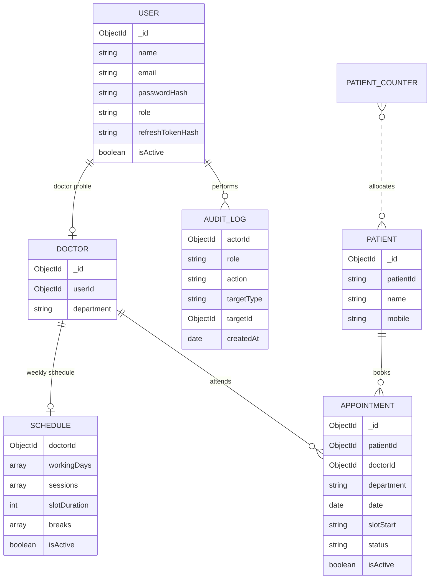

# Careflow — Enterprise EMR Appointment Management

Careflow is a role-based appointment-management application for a clinic. It includes a React/Vite web client and a Node.js/Express API backed by MongoDB. Staff can maintain doctor schedules, find or register patients, book and manage appointments, and see availability updates in real time.

## Project overview

Implemented capabilities:

- Staff login with bcrypt password hashing, short-lived access JWTs, rotating refresh JWTs, and logout invalidation.
- Role-based access control for `SUPER_ADMIN`, `RECEPTIONIST`, and `DOCTOR`.
- Doctor profiles and one weekly schedule per doctor with working days, multiple sessions, slot duration, breaks, and an active flag.
- Clinic-time-zone-aware slot generation. Past dates/times, break-overlapping slots, and incomplete session remainders are excluded.
- Patient lookup by generated patient ID, mobile number, or name; new patients can be registered separately or during appointment booking.
- Appointment create, list, detail, update, cancel, arrival, and completion APIs with server-side role and doctor ownership checks.
- Server-side appointment filters, sorting, and pagination with metadata.
- A MongoDB unique partial index as the final double-booking guard.
- Audit logs for login, appointment creation/update/cancellation, patient registration, and schedule changes.
- Authenticated Socket.IO events for appointment creation, update, and cancellation.
- Responsive role-specific React interfaces with React Query data loading, error handling, and live cache invalidation.

## Architecture overview

The `client/` and `server/` directories are separate applications. The client uses React Router for navigation, AuthContext for the signed-in user, the shared role configuration in `client/src/config/roleConfig.js`, one Axios client in `client/src/api/api.js` for API requests and token refresh, React Query for server state, and Socket.IO for event-driven invalidation.

The server follows a routes → validation/middleware → thin controllers → services → Mongoose models flow. Services own business rules and persistence. Shared utilities implement response formatting, audit logging, appointment workflow transitions, calendar handling, and slot generation. Express and Socket.IO share one HTTP server, and HTTP errors pass through a centralized error handler.

## Folder structure

```text
.
├── client/
│   ├── src/components/       # Layout, forms, feedback, role gates, and reusable UI
│   ├── src/api/              # Axios client and authentication-aware API requests
│   ├── src/config/           # Role permissions and role-specific navigation
│   ├── src/context/          # Authentication context
│   ├── src/hooks/            # Role, schedule editor, patient directory, and Socket.IO hooks
│   ├── src/pages/            # Login, dashboard, scheduler, appointments, patients, staff, schedules, audit logs
│   └── src/utils/            # Date helpers and client-side schedule validation
├── server/
│   ├── src/config/           # Environment and MongoDB connection
│   ├── src/controllers/      # HTTP request/response adapters
│   ├── src/middlewares/      # Authentication, authorization, validation/errors
│   ├── src/models/           # Mongoose collections and indexes
│   ├── src/routes/           # Versioned API routes
│   ├── src/scripts/          # Super Admin seed script
│   ├── src/services/         # Business logic and persistence
│   ├── src/socket/           # Socket authentication and appointment rooms
│   ├── src/utils/            # Shared domain, audit, response, and slot helpers
│   ├── src/validators/       # Joi request validation
│   └── test/                 # Node.js unit and API authorization tests
├── API_DOCUMENTATION.md
├── ENGINEERING_DECISIONS.md
└── README.md
```

## Database design



`Appointment.date` is the clinic calendar day stored at UTC midnight; `slotStart` is local `HH:mm` in `TIME_ZONE`. Department is copied onto the appointment at booking time. The unique partial index `{ doctorId, date, slotStart }` for `{ isActive: true }` prevents active appointments from sharing a slot. See [ENGINEERING_DECISIONS.md](./ENGINEERING_DECISIONS.md) for all declared indexes, their intended use, and scale considerations.

Schedule times use 24-hour `HH:mm`; weekday numbers are JavaScript values (`0` Sunday through `6` Saturday). All sessions apply to each selected working day. Breaks may be defined within sessions and any overlapping slot is omitted. Slot generation uses complete slot-duration intervals only; a remainder at the end of a session is intentionally unused.

## API documentation

The detailed request/response, authorization, filter, and Socket.IO reference is in [API_DOCUMENTATION.md](./API_DOCUMENTATION.md). The API prefix is `/api/v1`; responses use the envelope `{ success, message, data, meta }`.

Key endpoints:

| Method | Endpoint | Access | Purpose |
| --- | --- | --- | --- |
| `GET` | `/api/v1/health` | Public | API and database health |
| `POST` | `/api/v1/auth/login` | Public | Login |
| `POST` | `/api/v1/auth/refresh` | Public, refresh token required | Rotate refresh token |
| `POST` | `/api/v1/auth/logout` | Public, refresh token required | Invalidate refresh token |
| `GET` | `/api/v1/doctors` | Authenticated staff | List active doctors |
| `POST` | `/api/v1/admin/doctors` | Super Admin | Create a doctor |
| `POST` | `/api/v1/admin/receptionists` | Super Admin | Create a receptionist |
| `GET` | `/api/v1/admin/users?role=DOCTOR` | Super Admin | List doctors or receptionists |
| `PATCH` | `/api/v1/admin/users/:id` | Super Admin | Edit staff profile or account status |
| `GET` | `/api/v1/admin/audit-logs?page=1&pageSize=25` | Super Admin | Browse paginated audit events |
| `GET` | `/api/v1/doctors/:id/schedule` | Super Admin, Receptionist, own Doctor schedule | Read schedule |
| `PUT` | `/api/v1/doctors/:id/schedule` | Super Admin | Create or replace schedule |
| `GET` | `/api/v1/slots?doctorId=...&date=YYYY-MM-DD` | Authenticated staff | Get available/booked slots |
| `GET`, `POST` | `/api/v1/patients` | Super Admin, Receptionist | Search/list or register patients |
| `PATCH` | `/api/v1/patients/:patientId` | Super Admin, Receptionist | Update patient demographics |
| `POST` | `/api/v1/appointments` | Super Admin, Receptionist | Book existing or new patient |
| `GET` | `/api/v1/appointments` | All roles | List; Doctors are always scoped to self |
| `GET`, `PUT`, `PATCH` | `/api/v1/appointments/:appointmentId` | All roles, field/scope restrictions apply | Read or update |
| `DELETE` | `/api/v1/appointments/:appointmentId` | Super Admin, Receptionist | Cancel |
| `POST` | `/api/v1/appointments/:appointmentId/arrive` | Super Admin, Receptionist | Mark arrived |
| `POST` | `/api/v1/appointments/:appointmentId/cancel` | Super Admin, Receptionist | Cancel |
| `POST` | `/api/v1/appointments/:appointmentId/complete` | Super Admin | Complete |

## Environment variables

Copy `server/.env.example` to `server/.env` and `client/.env.example` to `client/.env`. Root and application `.env` files are ignored by Git. Never put server secrets in client `VITE_*` variables; Vite values are delivered to the browser.

| Variable | Application | Required | Meaning |
| --- | --- | --- | --- |
| `NODE_ENV` | Server | No | `development`, `test`, or `production` |
| `PORT` | Server | No | API port; default `5000` |
| `MONGODB_URI` | Server | Yes | MongoDB connection string |
| `MONGODB_DNS_SERVERS` | Server dev | No | Comma-separated DNS resolvers for `mongodb+srv` lookups; defaults to `1.1.1.1,8.8.8.8` in the dev command |
| `CLIENT_URL` | Server | No | Allowed browser origin(s), comma-separated; default `http://localhost:5173` |
| `TIME_ZONE` | Server | No | Valid IANA clinic time zone; default `Asia/Kolkata` |
| `ACCESS_TOKEN_SECRET` | Server | Yes | At least 32 characters |
| `REFRESH_TOKEN_SECRET` | Server | Yes | At least 32 characters and different from access secret |
| `ACCESS_TOKEN_EXPIRES_IN` | Server | No | JWT duration, default `15m` |
| `REFRESH_TOKEN_EXPIRES_IN` | Server | No | JWT duration, default `7d` |
| `RATE_LIMIT_WINDOW_MS` | Server | No | Positive integer window in milliseconds |
| `RATE_LIMIT_MAX` | Server | No | Positive integer request limit per window |
| `SEED_ADMIN_NAME` | Server seed | Seed only | Initial Super Admin name |
| `SEED_ADMIN_EMAIL` | Server seed | Seed only | Initial Super Admin email |
| `SEED_ADMIN_PASSWORD` | Server seed | Seed only | 12+ characters, at most 72 UTF-8 bytes |
| `VITE_API_URL` | Client | No | API base URL, default `http://localhost:5000/api/v1` |
| `VITE_SOCKET_URL` | Client | No | Socket.IO origin, default `http://localhost:5000` |

The server validates required settings during startup. Use unique, randomly generated secrets in deployment and do not reuse the example values.

## Installation instructions

Prerequisites: Node.js 20 or later, npm, and a reachable MongoDB instance. Docker is not used by this project.

In PowerShell, from the repository root:

```powershell
cd .\server
npm ci
Copy-Item .env.example .env
```

Edit `server/.env` with the MongoDB URI and two unique random token secrets (each 32+ characters). Set seed values before creating the first administrator. In a second PowerShell window:

```powershell
cd .\client
npm ci
Copy-Item .env.example .env
```

## Running the project

Start MongoDB first. Then start the API:

```powershell
cd .\server
npm run dev
```

The API listens on `http://localhost:5000`; check `http://localhost:5000/api/v1/health`.

Create the initial Super Admin once the server environment includes all three `SEED_ADMIN_*` values:

```powershell
cd .\server
npm run seed:admin
```

The seed is idempotent: it leaves an existing Super Admin unchanged and rejects a seed email already assigned to a non-admin user.

Start the web client in another PowerShell window:

```powershell
cd .\client
npm run dev
```

Open `http://localhost:5173`. For production builds, run `npm run build` in `client/`. Run server tests with `npm test` in `server/`.

## Role behavior

| Role | Main interface | Permissions |
| --- | --- | --- |
| `SUPER_ADMIN` | Dashboard, Staff (`/doctors`), Schedules, Scheduler, Appointments, Audit Logs | Manage doctor and receptionist accounts and schedules; view and manage all appointments; browse audit logs |
| `RECEPTIONIST` | Dashboard, Scheduler, Book Appointment, Appointments, Patients | Search/register/edit patients; book/update/cancel; mark arrived |
| `DOCTOR` | Dashboard, My Appointments | View only own appointments and patient summary; update consultation notes only |

The client hides disallowed navigation/actions and guards routes. These controls are for UX; API middleware and service-level ownership/field restrictions enforce access independently.

The frontend also provides a login page, dashboard, date-based scheduler with a live slot grid and booking form, appointment list with search/filter/sort/pagination, patient directory and editing form, Super Admin staff directory and schedule editor, and a Super Admin-only audit-log table.

## Assumptions made

- The installation represents one clinic/tenant; tenant isolation is not implemented.
- A doctor has one weekly schedule. Its working days share the same set of daily sessions, slot duration, and breaks.
- `TIME_ZONE` is the clinic's IANA time zone. Calendar dates are submitted as `YYYY-MM-DD` and slot times as `HH:mm`.
- Break periods can overlap sessions; generated slots intersecting a break are excluded. Incomplete slots at session ends are omitted.
- `SCHEDULED` and `ARRIVED` appointments hold a slot. `COMPLETED` and `CANCELLED` release it, while the appointment record remains for history.
- A new patient created as part of a booking is persisted only after the service verifies that the requested slot is available.
- Refresh-token storage is single-session per user (one current hashed refresh token); signing in again rotates/replaces that user's stored hash.
- Socket.IO events are invalidation hints. Clients refetch authoritative appointment and slot data from the API.

## Known limitations

- Access and refresh tokens are stored in browser `localStorage`; an XSS compromise could expose them. A production hardening step is refresh-token cookies with `HttpOnly`, `Secure`, and `SameSite` controls plus CSRF protection.
- The current deployment model is single clinic and uses one MongoDB connection. There is no tenant partitioning, distributed cache, or multi-instance Socket.IO adapter.
- No automated browser/e2e suite is included; manual UI checks are listed below.
- Appointment slot uniqueness is per doctor/date/start. There is no separate room/resource-capacity model, provider-specific session per weekday, recurring exception/holiday calendar, or waitlist.
- Past and break slots are excluded from slot responses rather than returned as disabled entries.
- The app does not include medical-record/clinical-note access beyond the appointment notes field, notification delivery, reporting/analytics, or a patient-facing portal.
- Search uses bounded/prefix-oriented filters and current indexes; real production query plans and index selectivity have not yet been measured with representative data.

## Future improvements

- Use secure refresh-token cookies and add CSP/XSS defenses, CSRF protections as appropriate, and security-focused integration tests.
- Add clinic/tenant ownership to all relevant records and enforce tenant scope in services, indexes, and authorization.
- Add browser e2e tests, accessible interaction tests, and load/concurrency tests using a real MongoDB replica set.
- Add doctor-specific day schedules, holidays/leave, recurring schedule exceptions, and optional room/resource constraints.
- Add a cross-instance Socket.IO adapter and durable job queue for notifications and asynchronous work.
- Use production query plans to refine indexes; introduce archival/retention and reporting read models as data volume grows.
- Add deployment observability, structured logs, metrics/tracing, backups, and restore/incident runbooks.

## Manual verification cases

Use two Super Admin or Receptionist sessions and a doctor with a configured future working day and open slot. Obtain valid tokens through `/api/v1/auth/login`. Send requests with `Authorization: Bearer <accessToken>`.

### Concurrent double-booking

1. Confirm `GET /api/v1/slots?doctorId=<doctorId>&date=<future-date>` returns the chosen time as `available`.
2. Prepare two valid `POST /api/v1/appointments` requests for the same doctor, date, and `slotStart`; use valid existing patient IDs or distinct new-patient payloads.
3. Send both requests concurrently from separate clients/processes.
4. Verify exactly one request succeeds and the other receives HTTP `409`; verify only one active appointment occupies that doctor/date/start. Confirm the losing new-patient payload did not leave an unintended patient record.
5. Cancel the winning appointment, then verify the slot can be booked again and that the historical cancelled appointment remains.

### Doctor-only access

1. Sign in as Doctor A and request the appointment list with no doctor filter; verify only Doctor A's appointments are returned.
2. Repeat while sending Doctor B's `doctorId` query parameter; verify results remain scoped to Doctor A.
3. Request Doctor B's appointment by ID and attempt to update its notes; verify both return `403`.
4. Update notes on Doctor A's own appointment; verify it succeeds. Try to change `purpose`, create an appointment, cancel, mark arrived, or complete; verify each is rejected.
5. Try to read Doctor B's schedule and subscribe to Doctor B's Socket.IO appointment room; verify both are denied. Reading Doctor A's schedule is permitted.

### Role-specific UI

1. Sign in as `SUPER_ADMIN`: verify Dashboard, Staff, Schedules, Scheduler, Appointments, and Audit Logs navigation; create staff and save a schedule; verify appointment management actions appear.
2. Sign in as `RECEPTIONIST`: verify Dashboard, Scheduler, Book Appointment, Appointments, and Patients navigation; search/register patients, book/update/cancel appointments, and mark arrival; verify staff creation and schedule editing are absent and direct navigation to those routes is forbidden.
3. Sign in as `DOCTOR`: verify Dashboard and My Appointments only; confirm there is no doctor filter, only own appointments appear, patient summary and notes editing are available, and booking/cancel/arrive/complete actions are absent.
4. For each role, sign out and open a protected route directly; verify redirection to `/login`. While signed in, directly visit a role-forbidden route and verify the `/403` page.
5. With two browser sessions open on the same doctor/date scheduler, book, update, and cancel an appointment in one session; verify the other session refreshes its slot and appointment data without a full-page reload.
